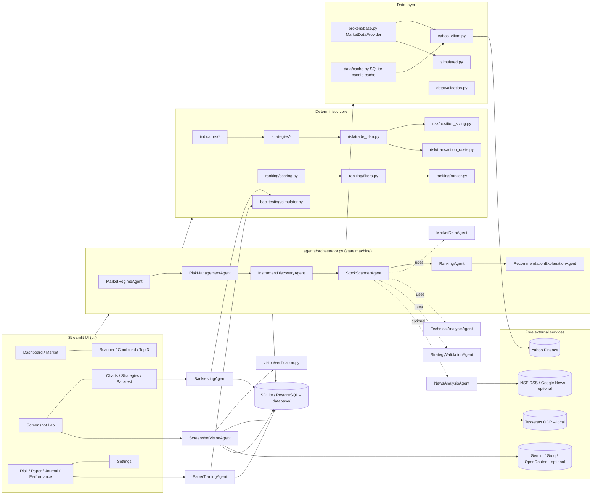

# Architecture

## Component diagram



## Data flow for one scan

```mermaid
sequenceDiagram
    participant U as User
    participant O as Orchestrator
    participant D as Data provider
    participant C as Core (indicators/strategies/risk)
    participant R as Ranking
    participant DB as Database
    U->>O: Run scan (universe, interval, screenshots, manual)
    O->>DB: create ScanRun (RUNNING)
    O->>D: NIFTY 50, BANK NIFTY, ETF proxies, VIX, sector indices
    O->>O: MARKET_CONTEXT → regime + sector RS
    O->>DB: today's paper trades → RISK_GATE (daily loss, trades, cooldown, exposure)
    loop each instrument (request budget)
        O->>D: daily candles → liquidity filter
        O->>D: intraday candles (completed only)
        O->>C: validate + freshness → indicators → 8 strategies on last completed candles
        alt signal found
            O->>D: quote (labelled LTP)
            O->>C: trade plan (trigger/limit/stop/targets/size/costs/status)
            O->>R: score 0–100 + mandatory rejection rules
        end
    end
    O->>O: SCREENSHOT_MERGE (re-analyse verified screenshot & manual symbols on fresh data)
    O->>R: RANKING (≤3, sector cap, correlation, exposure) – never forced
    O->>O: EXPLAINING (template; optional LLM guarded by number check)
    O->>DB: PERSISTING (candidates, recommendations, state log)
    O-->>U: DONE (cards) or NO_TRADE banner with reasons
```

## Screenshot pipeline

```mermaid
flowchart LR
    U[Upload PNG/JPG/WEBP] --> V[Validate: magic bytes, size, dimensions, bomb guard, SHA-256 dedupe]
    V --> PRE[OpenCV: grayscale, invert dark theme, upscale, denoise]
    PRE --> OCR[Tesseract words + positions + confidence]
    OCR --> PARSE[Parse symbol vs NSE universe, exchange, timeframe, OHLC legend, timestamp, EMA/VWAP/RSI/MACD labels]
    OCR --> AXIS[Fit price axis y→price (R² ≥ 0.98)]
    PRE --> GEO[Candle masks → trend; coloured horizontal lines → S/R]
    AXIS --> GEO
    PARSE & GEO --> EV[ScreenshotEvidence (value, confidence, source, flag per field)]
    EV -.optional.-> LLM[Vision LLM JSON → pydantic validation → fills gaps / flags disagreements]
    EV --> VERIFY[Verify: symbol exists, fresh candles, recompute indicators, compare price/trend/RSI/date]
    VERIFY -->|VERIFIED*| CAND[Candidate re-analysed by the normal pipeline]
    VERIFY -->|UNVERIFIED| REJ[Rejected – shown with reasons]
```

## Workflow states

`INIT → MARKET_CONTEXT → RISK_GATE → UNIVERSE → SCANNING → SCREENSHOT_MERGE → RANKING → EXPLAINING → PERSISTING → DONE | NO_TRADE | FAILED`

Each transition is timestamped in `ScanRun.state_log` and shown on the Combined AI Analysis page.

## Agents

| Agent | Input → Output |
|---|---|
| MarketDataAgent | `SymbolDataRequest` → `SymbolData` (intraday + daily CandleSets, validation, freshness) |
| MarketRegimeAgent | interval → (`RegimeResult`, sector DataFrame) |
| InstrumentDiscoveryAgent | `UniverseRequest` → `UniverseResult` (coverage note, partial-scan flag) |
| StockScannerAgent | `AnalysisRequest` → `SymbolAnalysis` (liquidity, indicators, scored candidates) |
| TechnicalAnalysisAgent | `SymbolData` → (indicator frame, S/R levels) |
| ScreenshotVisionAgent | (LoadedImage, use_llm) → `ScreenshotEvidence` |
| NewsAnalysisAgent | {symbol: name} → {symbol: [NewsItem]} (warnings only) |
| RiskManagementAgent | `DayState` → `RiskGate`; `plan()` builds `TradePlan` |
| StrategyValidationAgent | (symbol, indicators, interval) → [Signal] on completed candles |
| RankingAgent | ([Candidate], DayState) → (selected ≤ 3, skipped) |
| RecommendationExplanationAgent | (Candidate, use_llm) → ({section: text}, source) |
| BacktestingAgent | (symbols, strategies, interval, days) → BacktestResult |
| PaperTradingAgent | "refresh" / "day_state" → summary / DayState |

All agents return an `AgentResult(ok, output, errors, warnings, duration_ms)` and never raise into the workflow.

## Module dependency map

```
config  ←  everything
brokers.base  ←  brokers.yahoo_client, brokers.simulated, data.cache
data.market_hours  ←  data.validation, brokers.*, strategies.base, paper_trading
indicators.*  ←  strategies.*, market.regime, vision.verification
strategies.*  ←  risk.trade_plan (Signal), backtesting.engine, agents
risk.*  ←  ranking.filters, backtesting, paper_trading, agents
ranking.*  ←  agents
backtesting.simulator  ←  backtesting.engine, paper_trading.engine
vision.*  ←  agents.ScreenshotVisionAgent, ui.pages.screenshots
llm.*  ←  vision.chart_analyser, agents.RecommendationExplanationAgent
database.*  ←  agents.orchestrator, paper_trading, ui
ui.*  →  agents, database, (read-only use of core modules)
```

No core module imports `ui` or `streamlit`, so the core can be reused from scripts or another frontend.

## Database

See `database/schema.sql` (generated by `scripts/generate_schema.py`). Tables:

- `instruments`, `market_snapshots`, `indicator_snapshots`
- `scan_runs`, `candidate_rankings`, `recommendations`
- `screenshots`, `image_evidence`
- `paper_trades`, `trade_journal`, `backtest_runs`
- `user_settings`, `audit_logs`, `schema_version`

The high-volume candle cache lives in `storage/candle_cache.sqlite`, keyed by `(symbol, interval, ts)` with upserts, so it never holds duplicates.

Migrations are versioned in `database/db.py::MIGRATIONS` and applied on start-up.
